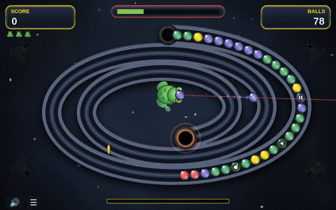
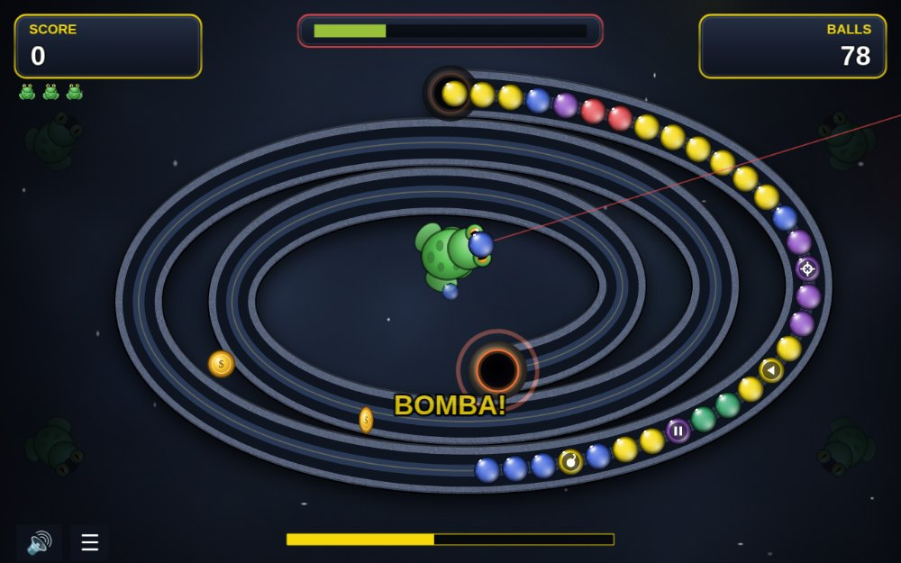
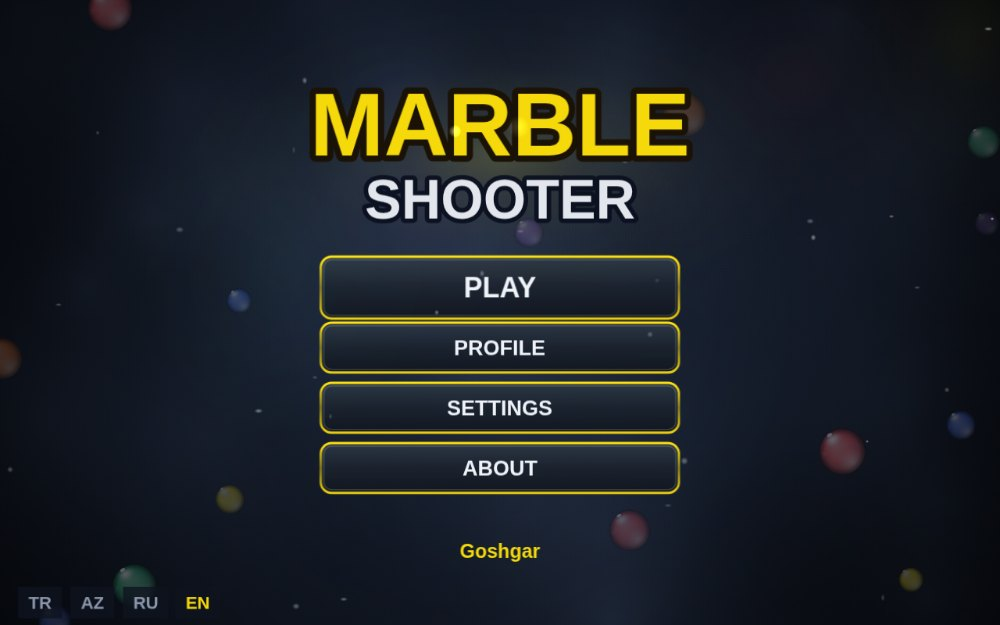
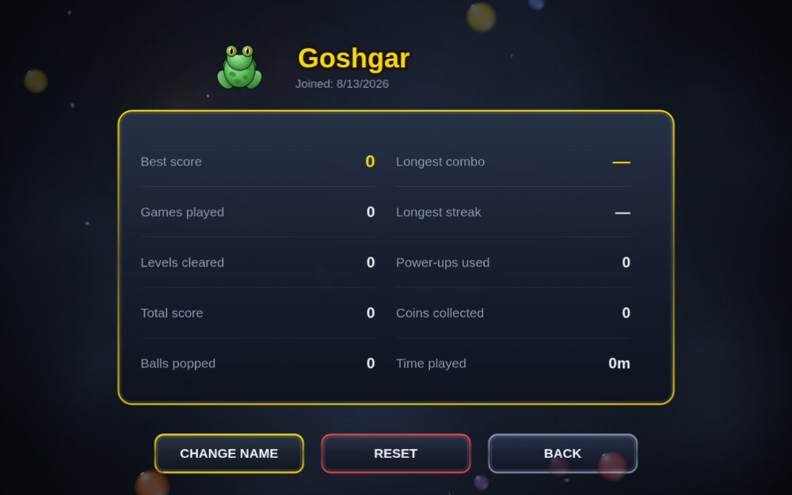
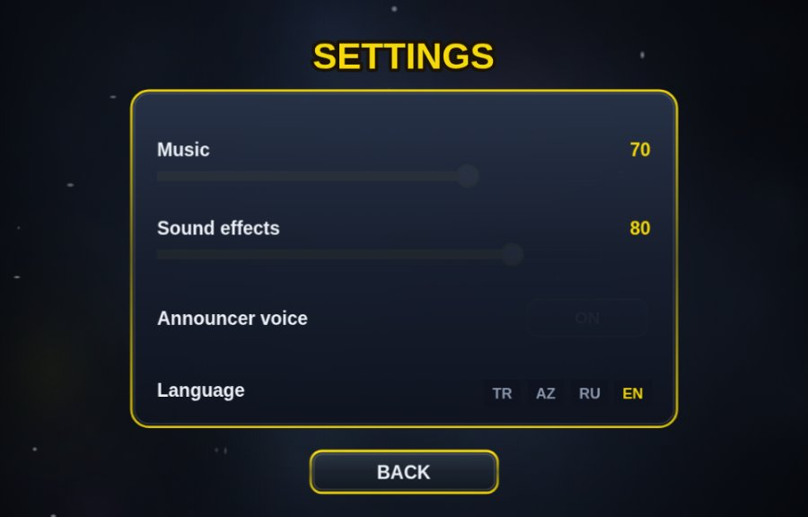
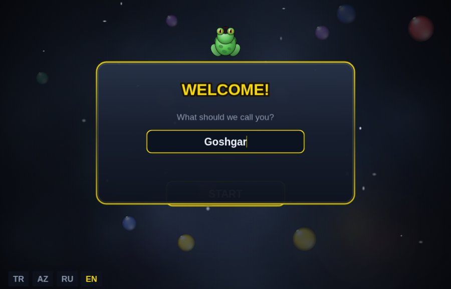
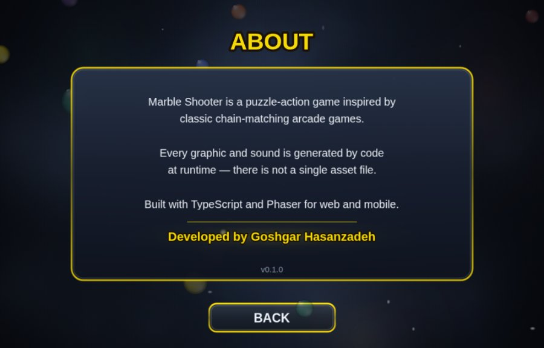
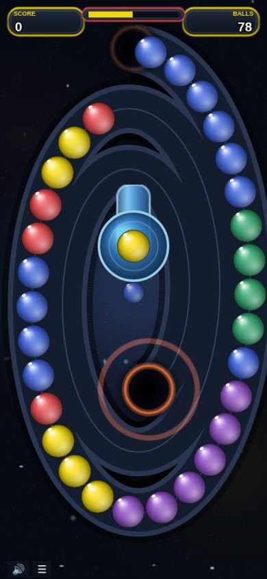

<div align="center">

# Marble Shooter

**A Zuma-style marble shooter for web and mobile — with zero asset files.**

Every graphic, sound effect and music note is synthesised at runtime.
No sprites, no audio files, no fonts to download.

[](https://www.typescriptlang.org/)
[](https://phaser.io/)
[](https://vite.dev/)
[](#testing)
[](#size-budget)

[Technical notes →](docs/TECHNICAL.md)

</div>

---

<div align="center">

<br><sub>Live capture — matches, chain reactions, power-ups and the laser sight</sub>
</div>

## Table of contents

- [Highlights](#highlights)
- [Screenshots](#screenshots)
- [Quick start](#quick-start)
- [How it works](#how-it-works)
- [Gameplay features](#gameplay-features)
- [Project structure](#project-structure)
- [Testing](#testing)
- [Size budget](#size-budget)
- [Technical notes](docs/TECHNICAL.md)
- [Roadmap](#roadmap)
- [Credits](#credits)
- [Support](#support)

## Highlights

**Zero asset files.** Marbles, the stone track, the frog shooter, the mouse
cursor, particle sprites, UI panels — all drawn with the Canvas 2D API at
startup. Music and every sound effect are synthesised with the Web Audio API.
The whole game ships in a single JavaScript bundle.

**Engine-independent game logic.** The entire simulation lives in `src/core/`
and never imports Phaser. It runs headless under `node:test`, so gameplay
rules are verified in milliseconds without opening a browser.

**Genuinely responsive.** The layout is not a fixed design scaled to fit — it
is rebuilt from the real viewport. The spiral reshapes to the screen's aspect
ratio, and ball sizes and speeds scale with it so pacing is identical on a
phone and a desktop.

**Four languages.** Turkish, Azerbaijani, Russian and English, with a typed
dictionary that turns a missing translation into a compile error.

## Screenshots

<table>
<tr>
<td width="50%">

<p align="center"><b>Gameplay</b><br><sub>Power-up marbles, coins, laser sight, lives and the Zuma meter</sub></p>
</td>
<td width="50%">

<p align="center"><b>Main menu</b><br><sub>Drifting marbles, animated title, four languages</sub></p>
</td>
</tr>
<tr>
<td width="50%">

<p align="center"><b>Player profile</b><br><sub>Ten persistent statistics, rename and reset</sub></p>
</td>
<td width="50%">

<p align="center"><b>Settings</b><br><sub>Music and SFX sliders, announcer toggle, language</sub></p>
</td>
</tr>
<tr>
<td width="50%">

<p align="center"><b>First launch</b><br><sub>Name asked once, then never again</sub></p>
</td>
<td width="50%">

<p align="center"><b>About</b><br><sub>Credits with an animated signature</sub></p>
</td>
</tr>
</table>

<div align="center">

<p><b>Portrait phone</b><br><sub>The spiral reshapes to the aspect ratio — no letterboxing, no shrunken canvas</sub></p>
</div>

## Quick start

```bash
npm install
npm run dev        # http://localhost:5173
```

| Command | Description |
|---|---|
| `npm run dev` | Development server with hot reload |
| `npm run build` | Type-check and produce a production bundle |
| `npm run preview` | Serve the production build locally |
| `npm test` | Core simulation tests (no browser needed) |
| `npm run size` | Report bundle size and largest files |

**Controls** — move to aim, click or tap to shoot, right-click or `Space` to
swap the loaded marble, `Esc` for the menu.

> Click once before expecting sound: browsers block audio until the first
> user gesture.

## How it works

### The chain is one-dimensional

Balls have no 2D position. Each ball stores a single number: the distance it
has travelled along the path. Screen position is derived every frame with
`path.pointAt(d)`.

```ts
interface Ball {
  id: number
  color: number
  d: number        // distance along the path — the only stored position
  power?: PowerUp
}
```

This one decision collapses the hard parts of the genre into plain
arithmetic. Inserting a marble is an array splice plus an offset. Closing a
gap is a subtraction. Chain reactions fall out of re-running the match check
at the junction where two segments meet. No physics engine is involved, the
simulation is deterministic, and every rule is unit-testable.

Positions are parameterised by **arc length**, not by the curve's `t`
parameter — on a spiral those are very different, and balls would bunch up
in the tight sections otherwise.

### Balls queue outside the track

New marbles are born with a **negative** distance: they wait inside the cave
and emerge as the chain marches. A level's whole supply is queued up front,
and `preFill` puts part of it on the track so the opening is not empty.

### Explosions push the chain back

When a match clears, the part of the chain **closer to the skull retreats**
to close the gap — the section behind it stays put. Each combo adds a
stronger knockback impulse, and after a big chain reaction the whole line
pauses for a moment before rolling forward again. That recoil is the reward
loop the genre is built on.

### Rendering is a pure projection

`ChainView` holds no state. Every frame it reads the core model and moves
pooled sprites; nothing is created or destroyed during play, which keeps
garbage-collection pauses off mobile browsers.

## Gameplay features

**Power-ups** attach to a random marble and revert if you do not destroy them
in time.

| Power-up | Effect |
|---|---|
| 💣 Bomb | Destroys every marble within a radius, any colour |
| ⏸ Slow | Chain drops to 32% speed for 8 seconds |
| ◀ Backwards | Chain runs away from the skull for 4.5 seconds |
| ⊕ Accuracy | Laser sight, and fire rate from 300 ms to 110 ms |

**Scoring**

- **Gap shot** — thread a marble between two balls to hit the chain beyond
  them. Each gap crossed multiplies the bonus.
- **Streak** — five or more consecutive shots that all destroy something.
- **Combo** — chain reactions score a flat bonus on top and knock the chain
  further back each step.
- **Coins** appear beyond the chain; hitting one does not break your streak.
- **Level bonus** from the track left between the skull and the last marble.

**Progression** — three lives, an extra life every 12,000 points, and a meter
that stops the ball supply once filled so you only have to clear what is on
screen.

**Player profile** — name asked once on first launch, then persistent stats:
best score, games played, levels cleared, balls popped, longest combo and
streak, power-ups used, coins collected and time played.

## Project structure

```
src/
  core/          Pure TypeScript. Never imports Phaser.
    Chain.ts       chain model: march, insert, match, knockback, power-ups
    Polyline.ts    arc-length parameterised path
    config.ts      screen-scaled constants
    balance.ts     every tunable number
  game/          Phaser layer. Draws only, holds no rules.
    GameScene.ts   wires everything together
    ChainView.ts   pooled sprites, stateless renderer
    Shooter.ts     frog, projectiles, gap detection
    textures.ts    every graphic, generated with Canvas 2D
    layout.ts      layout derived from the real viewport
    Fx.ts          particles, shock rings, screen shake
  audio/         Web Audio synthesis: music, SFX, announcer voice
  ads/           Ad provider abstraction (Poki / CrazyGames / LevelPlay)
  i18n/          tr, az, ru, en
  profile.ts     player profile and statistics
test/            core tests — node:test, no browser
```

### Tuning

Every number lives in `src/core/balance.ts`. It is designed to be loaded from
JSON and driven by remote config later, so balance can change without an app
store release.

> For the rendering pipeline, audio synthesis, responsive-layout maths and the
> genre research behind the mechanics, see **[docs/TECHNICAL.md](docs/TECHNICAL.md)**.

## Testing

```bash
npm test
```

18 tests cover the simulation: arc-length maths, spacing invariants,
match detection, segment splitting, combo chain reactions, knockback
escalation, power-up behaviour and lose conditions. They import `src/core`
directly and run in about 200 ms.

Because the core has no Phaser dependency, balance changes can be validated
by simulating thousands of frames in a test rather than by playing.

## Size budget

Web game portals gate on download size, which shapes the whole technical
approach:

| Portal | Limit |
|---|---|
| Poki | initial download **< 8 MB** |
| CrazyGames | first playable ≤ 50 MB, ≤ 20 MB for mobile homepage |

Current build: **~364 KB gzipped**, with no image or audio files at all.
Generating assets in code instead of shipping them keeps the entire budget
available for future content.

## Roadmap

- [ ] Multiple levels with hand-authored paths and a level editor
- [ ] Tunnels, and levels with two simultaneous chains
- [ ] Ace-time bonus and temple progression
- [ ] Android build via Capacitor with LevelPlay mediation
- [ ] Poki and CrazyGames SDK providers under `src/ads/`

## Credits

Developed by **Goshgar Hasanzade**.

Built with [Phaser 3](https://phaser.io/), [TypeScript](https://www.typescriptlang.org/)
and [Vite](https://vite.dev/).

> **Naming note:** *Zuma* is a trademark of PopCap/EA. The genre is free to
> build in; the name is not. This project is called Marble Shooter and does
> not use that mark in its title or store listing.

## Support

If you enjoy this project, you can support its development:

<!-- KO-FI: replace <handle> with your Ko-fi username to activate. -->
<!--
[](https://ko-fi.com/<handle>)
-->

Starring the repository also helps more than you would think.

### License

No license is specified yet, so default copyright applies — all rights
reserved. If you want others to reuse the code, add a `LICENSE` file; a
permissive licence such as MIT would let anyone ship this commercially, so
that choice is deliberately left open.
